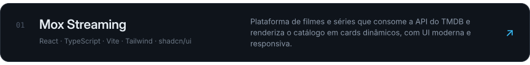
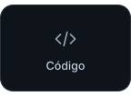
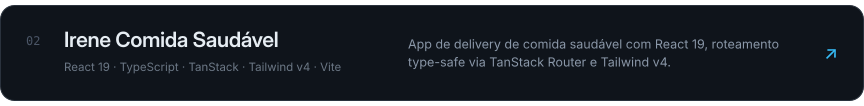
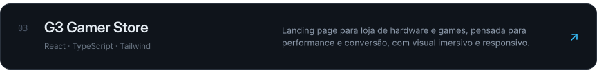
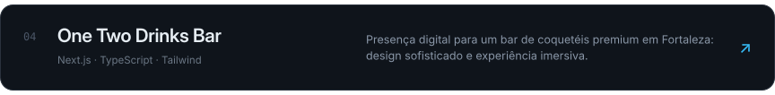

[Portfólio](https://kayohancostadev.vercel.app/) · [Mox Desenvolvimento](https://mox-desenvolvimento.vercel.app/) · [LinkedIn](https://www.linkedin.com/in/kayohancostadev/) · [E-mail](mailto:kayohancostadev@gmail.com)

## Sobre

Desenvolvedor **Full Stack** com foco em **front-end**. Cuido do caminho inteiro, do protótipo no Figma ao deploy em produção, sem perder fidelidade no meio. Gosto de interfaces rápidas, acessíveis e com cara de produto, não de template.

Atuo também à frente da [Mox Desenvolvimento e Soluções Web](https://mox-desenvolvimento.vercel.app/), criando sites e sistemas para negócios. Cursando Análise e Desenvolvimento de Sistemas (Estácio, 5º semestre), em Fortaleza, CE.

## Como eu trabalho

- **Performance é feature.** Next.js e Vite, renderização consciente, imagens e bundles sob controle.
- **Design → código sem ruído.** Prototipo no Figma e implemento com tokens, componentes e responsividade desde o início.
- **Tipagem como documentação.** TypeScript de ponta a ponta para contratos claros e refatoração segura.
- **Entrega contínua.** Git + Vercel/Netlify: cada push vira preview, cada merge vira produção.

## Stack

## Projetos

 
 
 
 
 
 
 

Todos os projetos em [kayohancostadev.vercel.app/projects](https://kayohancostadev.vercel.app/projects)

## Atividade

## Contato

Aberto a oportunidades como **Front-end / Full Stack**.

[Portfólio](https://kayohancostadev.vercel.app/) · [Mox Desenvolvimento](https://mox-desenvolvimento.vercel.app/) · [LinkedIn](https://www.linkedin.com/in/kayohancostadev/) · [Instagram](https://www.instagram.com/KayohanCostadev/) · [WhatsApp](https://wa.me/5585998213158) · [E-mail](mailto:kayohancostadev@gmail.com)
