 

 

## `01` · Sobre

Desenvolvedor **Full Stack** com foco em **front-end**. Eu cuido do caminho inteiro: do protótipo no Figma ao deploy em produção, sem perder fidelidade no meio.
Gosto de interfaces rápidas, acessíveis e com cara de produto, não de template.

Atuo também à frente da [**Mox Desenvolvimento e Soluções Web**](https://mox-desenvolvimento.vercel.app/), criando sites e sistemas para negócios.

Cursando **Análise e Desenvolvimento de Sistemas** (Estácio, 5º semestre), em Fortaleza 🇧🇷.

 

## `02` · Como eu trabalho

| | Princípio | Na prática |
|:-:|---|---|
| ⚡ | **Performance é feature** | Next.js/Vite, renderização consciente, imagens e bundles sob controle. |
| 🎯 | **Design → código sem ruído** | Prototipo no Figma e implemento com tokens, componentes e responsividade desde o início. |
| 🧱 | **Tipagem como documentação** | TypeScript de ponta a ponta para contratos claros e refatoração segura. |
| 🚢 | **Entrega contínua** | Git + Vercel/Netlify: cada push vira preview, cada merge vira produção. |

 

## `03` · Stack

 

## `04` · Projetos

<table>
<tr>
<td width="50%" valign="top">

### 🎬 Mox Streaming
Plataforma de filmes e séries que consome a API do **TMDB** e renderiza o catálogo em cards dinâmicos, com UI moderna e responsiva.

`React` `TypeScript` `Vite` `Tailwind` `shadcn/ui`

[**Código →**](https://github.com/KayohanCosta/Mox-Streaming) · [**Demo →**](https://mox-streaming.vercel.app/)

</td>
<td width="50%" valign="top">

### 🥗 Irene Comida Saudável
App de delivery de comida saudável com **React 19**, roteamento type-safe via **TanStack Router** e **Tailwind v4**.

`React 19` `TypeScript` `TanStack` `Tailwind v4` `Vite`

[**Código →**](https://github.com/KayohanCosta/Irene-Comida-Suadavel) · [**Demo →**](https://irenecomidasaudavel.vercel.app/)

</td>
</tr>
<tr>
<td width="50%" valign="top">

### 🕹️ G3 Gamer Store
Landing page para loja de hardware e games, pensada para **performance e conversão**, com visual imersivo e responsivo.

`React` `TypeScript` `Tailwind`

[**Código →**](https://github.com/KayohanCosta/g3-gamer-store) · [**Demo →**](https://g3gamerstore.vercel.app/)

</td>
<td width="50%" valign="top">

### 🍹 One Two Drinks Bar
Presença digital para um bar de coquetéis premium em Fortaleza: design sofisticado e experiência imersiva.

`Next.js` `TypeScript` `Tailwind`

[**Código →**](https://github.com/KayohanCosta/One-Two-drinks) · [**Demo →**](https://onetwodrink.vercel.app/)

</td>
</tr>
</table>

Todos os projetos em <a href="https://kayohancostadev.vercel.app/projects">kayohancostadev.vercel.app/projects</a>

 

## `05` · Atividade

 

## `06` · Contato

Aberto a oportunidades como **Front-end / Full Stack**. Para projetos e soluções web sob demanda, conheça a [**Mox Desenvolvimento e Soluções Web**](https://mox-desenvolvimento.vercel.app/).

<code>© Kayohan Costa · feito à mão, sem widgets de terceiros</code>

